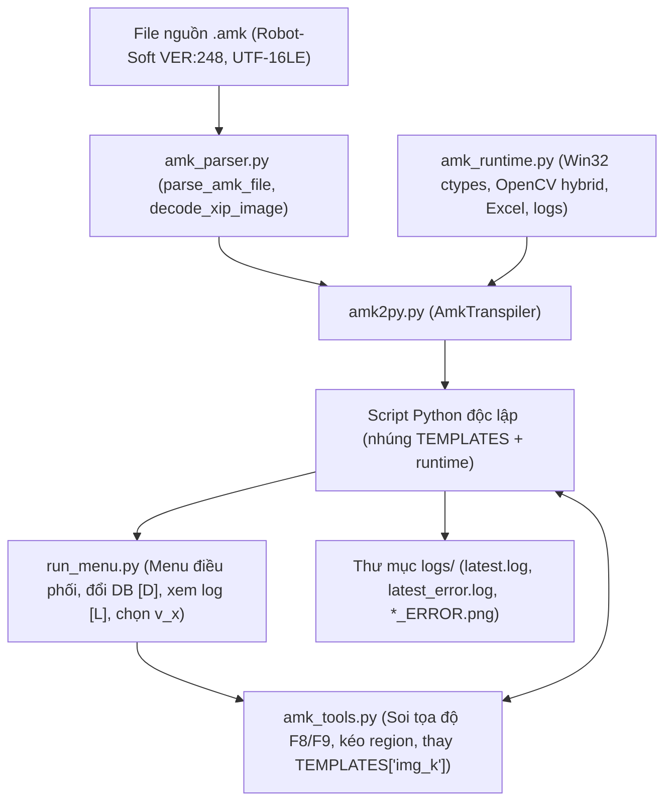

# Tài liệu kỹ thuật & hướng dẫn bảo trì hệ thống tự động hóa HIS (AMK sang Python)

Tài liệu này mô tả toàn bộ kiến trúc mã nguồn, đặc tả định dạng `.amk`, cơ chế thực thi Win32/OpenCV, hệ thống nhật ký chẩn đoán lỗi (`logs\`) và quy trình thao tác chuẩn (SOP) dành cho **AI Agent bảo trì** khi chạy trên bất kỳ máy tính nào khác.

---

## 1. Tổng quan dự án & bản đồ thư mục triển khai

### 1.1. Sơ đồ kiến trúc tổng thể



### 1.2. Bản đồ thư mục nguồn & 3 máy trạm triển khai

| Thành phần | Đường dẫn | Ghi chú vận hành |
| :--- | :--- | :--- |
| **Kho mã nguồn gốc (công cụ & test)** | `C:\Users\Thinkpad T14 gen 2\.gemini\antigravity\scratch\amk_to_python_may4\` | Chứa `amk_parser.py`, `amk2py.py`, `amk_runtime.py`, `amk_tools.py`, `run_menu.py`, `tests\test_converter.py`, `generate_tutorial_video.py`. |
| **Bản sao cục bộ (3 máy)** | `Python\` (Máy 4), `Python_May3\` (Máy 3), `Python_May2\` (Máy 2) trong thư mục gốc trên | Bản sao đồng bộ tại máy lập trình để kiểm thử/chỉnh sửa offline khi không nối mạng LAN bệnh viện. |
| **Máy 4 trên mạng LAN khoa HSTC** | `\\10.3.31.248\thongtinbv_lichtruc\KHOA HỒI SỨC TÍCH CỰC\BS ManhPham\Crack\HSTC\May 4\Python\` | `Database` gốc: `C:\Users\Administrator\Desktop\Database`. Gồm 12 script nghiệp vụ. |
| **Máy 3 trên mạng LAN khoa HSTC** | `\\10.3.31.248\thongtinbv_lichtruc\KHOA HỒI SỨC TÍCH CỰC\BS ManhPham\Crack\HSTC\May 3\Python\` | `Database` gốc: `C:\Users\HG - PC\Desktop\Database`. Gồm 13 script (có thêm `TEST F7.py`). |
| **Máy 2 trên mạng LAN khoa HSTC** | `\\10.3.31.248\thongtinbv_lichtruc\KHOA HỒI SỨC TÍCH CỰC\BS ManhPham\Crack\HSTC\May 2\Python\` | `Database` gốc: `C:\Users\User\Desktop\Database`. Gồm 12 script (`Ký phiếu máu ( bác sĩ ).py`). |
| **File Excel dùng chung trên mạng** | `\\10.3.31.248\thongtinbv_lichtruc\KHOA HỒI SỨC TÍCH CỰC\BS ManhPham\Crack\Database.xlsx` | Được `AmkRuntime._resolve_excel_path()` tự động dò lên 3 cấp thư mục cha nếu không có trên Desktop. |

### 1.3. Quy chuẩn bắt buộc khi bảo trì

1. **Không sửa hoặc xóa tài nguyên `.amk`, `.exe`, `.dll` gốc** ở thư mục cha (`May 4\`, `May 3\`, `May 2\`). Mọi thao tác bảo trì chỉ thực hiện trong thư mục `Python\`.
2. **Không chạy lại `amk2py.py` để ghi đè lên các script đã vá phẫu thuật:** Đặc biệt là `Ky so F6 new.py` trên **Máy 3** và **Máy 2**, vì các file này đã được vá trực tiếp theo bộ mẫu logo và `"BÁC SĨ ĐIỀU TRỊ"` ngày `17/11/2026` của Máy 4 trong khi file `.amk` gốc trên Máy 3 vẫn là bản cũ (`20/09/2026`).
3. **Luôn tạo bản sao lưu trước khi sửa:** Tạo file `.bak` cùng tên hoặc dùng `amk_tools.replace_template_in_script()` (tự động sao lưu vào `backups\<Ten_Script>_YYYYMMDD_HHMMSS.py`).
4. **Dọn sạch thư mục `__pycache__`:** Trước khi kết thúc phiên bảo trì trên thư mục mạng (`May 4\Python`, `May 3\Python`, `May 2\Python`), luôn xóa `__pycache__` để giữ thư mục triển khai sạch sẽ (khi biên dịch kiểm tra dùng `py_compile` vào file tạm hoặc `python -B`).
5. **Mỗi script thành phẩm là một tệp độc lập:** `amk2py.py` nhúng trực tiếp toàn bộ `TEMPLATES` (ảnh PNG Base64) và phần thân của `amk_runtime.py` (từ dòng `# Win32 constants` trở đi) vào từng script `.py`. Khi sửa `amk_runtime.py`, bản sửa **không tự động có hiệu lực** đối với các script đã biên dịch trừ khi bạn cập nhật thân runtime trong từng script (hoặc chạy tái tạo các script chưa vá riêng, sau đó giữ/áp lại phần vá riêng nếu có).

---

## 2. Đặc tả định dạng `.amk` (`VER:248`) & giải mã ảnh `XIP\0`

### 2.1. Cấu trúc văn bản `.amk` (`amk_parser.py`)

- **Bảng mã:** Tệp `.amk` của Robot-Soft Automatic Mouse and Keyboard là văn bản **UTF-16LE** có BOM (`0xFF 0xFE`). Hàm `parse_amk_file()` hỗ trợ tự động cả `utf-16`, `utf-8-sig` và `utf-16-le` không BOM.
- **Cú pháp gần JSON:** Tệp có gốc `{@AS:..., VER:248, I:[...]}`. Khác với JSON chuẩn ở chỗ:
  - Khóa đối tượng không cần bọc ngoặc kép (`TYPE:2`, `#SUB:{...}`, `$VAR:"$x"`).
  - Tiền tố khóa thể hiện kiểu nút con: `#` là đối tượng lồng/biểu thức (`#COD`, `#SUB`, `#VAL`, `#XP`, `#YP`, `#XO`, `#YO`, `#V1`, `#V2`), `$` là chuỗi ký tự (`$VAR`, `$FUN`, `$NAM`, `$WHR`, `$TUN`, `$FDO`, `$TDO`, `$TIT`, `$CMT`).
  - **Không có dấu phẩy** sau các cặp giá trị là đối tượng lồng nhau (ví dụ `#XO:{...}\r\n#YO:{...}`). Vì vậy `parse_amk_text()` dùng bộ phân tích đệ quy viết tay thay vì `json.loads()`.

### 2.2. Giải mã ảnh nhị phân `XIP\0` (`decode_xip_image`)

Mỗi thuộc tính `IMG0`, `IMG1`, ... trong câu lệnh tìm ảnh lưu ảnh mẫu dưới dạng chuỗi hex bắt đầu bằng `0x`. Sau khi chuyển sang `bytes`:
- **32 byte header đầu tiên** giải nén bằng `struct.unpack("<6I4sI", raw[:32])`:
  - `u0 = 87`, `u1 = 4`
  - `w`: chiều rộng ảnh (pixel) tại vị trí thứ 3 (`uint32`)
  - `u3 = 72`, `u4 = 4`
  - `h`: chiều cao ảnh (pixel) tại vị trí thứ 6 (`uint32`)
  - `tag = b"XIP\x00"` (4 byte chữ ký)
  - `datalen = w * h * 4` (tổng số byte dữ liệu điểm ảnh)
- **Phần thân điểm ảnh (`raw[32:]`):** Ma trận `BGRA` 8-bit thứ tự từ trên xuống dưới (`top-down`), kích thước `(h, w, 4)`. `decode_xip_image()` cắt 3 kênh đầu `bgra[:, :, :3]` thành mảng `BGR` chuẩn OpenCV, rồi `encode_bgr_png_b64()` nén lossless thành PNG Base64 đưa vào từ điển `TEMPLATES`.

### 2.3. Bảng tra cứu `TYPE` lệnh & biểu thức (`amk2py.py`)

| Nhóm | Giá trị `TYPE` | Ý nghĩa trong `.amk` | Sinh mã Python tương ứng |
| :--- | :---: | :--- | :--- |
| **Lệnh (`SUPPORTED_STMT_TYPES`)** | `2` | Find Image (`IF:1` nếu là điều kiện `if`) | `rt.find_image([('img_k', sml), ...], region=..., timeout=..., ...)` |
| | `3` | Mouse Drag Offset (`#XO`, `#YO`) | `rt.mouse_drag_offset(dx, dy)` |
| | `4` | Mouse Move Offset (`#XO`, `#YO`) | `rt.mouse_move_offset(dx, dy)` |
| | `5` | Mouse Click (`MBTN` 0=trái/1=phải/2=giữa, `CLKT` 0=đơn/1=đúp) | `rt.mouse_click(button=..., click_type=...)` |
| | `6` / `7` | `ELSE` / `END_IF` (đóng khối `if` kết hợp `DLY`) | `else:` / `rt.sleep_ms(...)` |
| | `8` / `9` | `LOOP` / `END_LOOP` (`LPTP`: `0`=cố định, `3`=while, `4`=for đếm gồm cả cận trên) | `for _ in range(...)` / `while rt.truthy(...) and rt.loop_guard(...)` / `for v_i in range(int(v1), int(v2) + 1)` |
| | `11` | Break vòng lặp | `break` |
| | `12` | Mouse Move Absolute (`#XP`, `#YP`) | `rt.mouse_move_abs(xp, yp)` |
| | `15` | Key Press (`KEY`, `CTRL`, `SHFT`, `ALT`, `WIN`, `NKEY`) | `rt.key_press(0xVK, ctrl=..., shift=..., alt=..., win=..., count=...)` |
| | `17` / `18` | Key Down / Key Up | `rt.key_down(0xVK)` / `rt.key_up(0xVK)` |
| | `29` | Wait Window (`$TIT`, `APPR`, `TOUT`, `$TUN`, `SWIT`) | `rt.wait_window(title, appear=..., timeout=..., unit=..., switch=...)` |
| | `33` | Gán biến (`SET $VAR = #VAL`) | `v_x = ...` (hoặc `rt.get_start_row(...)` nếu là con trỏ dòng Excel `v_x`) |
| | `34` / `36` | Gọi hàm biểu thức (`#COD`) / Điều kiện `IF (#COD)` | Gọi trực tiếp hàm `rt.*` hoặc `if ...:` |
| | `43` | Ghi chú (`$CMT`) | `# <comment>` |
| | `46` / `47` | Khai báo khối/hàm (`$FUN`); khối lồng bên trong được inline | `def func_<name>(rt: AmkRuntime) -> None:` hoặc `# [Nested block: ...]` |
| **Biểu thức (`SUPPORTED_EXPR_TYPES`)** | `43` / `45` / `1024` | Cộng hoặc nối chuỗi / Trừ / So sánh bằng | `rt.add(v1, v2)` / `rt.sub(v1, v2)` / `rt.eq(v1, v2)` |
| | `256` / `257` / `258` / `262` / `2052` / `2089` | Biến / Số / Chuỗi / Null / Bool / Tên hàm tùy biến | `v_name` / literal / `None` / `bool` / `func_name` |
| | `2049` | Hàm dựng sẵn (`$FUN` trong `SUPPORTED_BUILTIN_FUNCS`) | `MessageBox`, `TypeText`, `GetMousePositionX`, `GetMousePositionY`, `Rect`, `CaptureScreen`, `InvokeCustomFunction`, `XLS_Open`, `XLS_GetCell`, `Variable.RefCount` |

---

## 3. Kiến trúc Runtime tự động hóa (`amk_runtime.py`)

### 3.1. Xử lý DPI màn hình & thao tác Win32 thuần `ctypes`

- **Per-Monitor DPI Awareness v2:** Ngay khi khởi tạo `AmkRuntime` hoặc chạy `amk_tools.py` / `run_menu.py`, hàm `_enable_dpi_awareness()` gọi `user32.SetProcessDpiAwarenessContext(ctypes.c_void_p(-4))` (fallback `SetProcessDpiAwareness(2)` và `SetProcessDPIAware()`). Điều này đảm bảo trên các máy đặt tỷ lệ hiển thị Windows **125%** hoặc **150%**, hệ tọa độ `BitBlt`, `GetCursorPos`, `SetCursorPos` và lớp phủ Tkinter luôn tính theo **pixel vật lý 1:1** (ví dụ `1920x1080`), khớp chính xác với tọa độ chụp trong `.amk`.
- **Cấu trúc `SendInput` 64-bit:** `INPUT` dùng `_INPUT_UNION` chứa `MOUSEINPUT`, `KEYBDINPUT`, `HARDWAREINPUT` với `ULONG_PTR = ctypes.c_size_t`, đảm bảo `ctypes.sizeof(INPUT) == 40` trên Python 64-bit (28 byte trên 32-bit).
- **Nhập liệu tiếng Việt & phím nóng:**
  - `type_text(text, use_clipboard=False)`: Khi `use_clipboard=True`, ghi UTF-16LE (`CF_UNICODETEXT`) vào Win32 Clipboard qua `GlobalAlloc`/`GlobalLock`/`SetClipboardData` rồi gửi `Ctrl+V` (`0x56`). Khi `False`, gửi trực tiếp từng mã UTF-16 qua `KEYEVENTF_UNICODE` (`wScan`), xử lý riêng `\r`, `\n` (`VK_RETURN = 0x0D`) và `\t` (`VK_TAB = 0x09`).
- **Dừng khẩn cấp `F12` (`check_stop` & `release_held_inputs`):**
  - Mọi bước di chuột, bấm phím, ngủ (`_sleep_ms_raw` chia nhỏ từng đoạn 20ms) và vòng lặp chờ ảnh/cửa sổ (30ms/lượt) đều kiểm tra `GetAsyncKeyState(VK_F12) & 0x8000`.
  - Khi dừng khẩn cấp hoặc có ngoại lệ, `finally` luôn gọi `release_held_inputs()` để nhả `MOUSEEVENTF_LEFTUP` và mọi phím đang giữ trong `_held_vks`.

### 3.2. Thuật toán so khớp ảnh lai (`match_template_hybrid`)

Thuật toán này giải quyết đồng thời hai bài toán đối lập trên giao diện HIS: phân biệt chữ nhỏ gần giống nhau (ví dụ tên 74 bác sĩ) và nhận diện ô màu đồng nhất (nền vàng, nền xám).

```python
ch_std_max = float(tmpl_bgr.std(axis=(0, 1)).max())
```

1. **Nhánh 1 — Ảnh đơn sắc / ít biến thiên không gian (`ch_std_max < 8.0`):**
   - Dùng độ lệch chuẩn không gian **lớn nhất trên từng kênh B, G, R** (`axis=(0, 1)`), **tuyệt đối không dùng** `tmpl_bgr.std()` gộp 3 kênh. Lý do: ô màu vàng nhạt `[224, 255, 255]` có `tmpl_bgr.std() == 14.61` dù từng kênh phẳng lì (`ch_std_max == 0.0`).
   - Sử dụng `cv2.matchTemplate(screen_bgr, tmpl_bgr, cv2.TM_SQDIFF)` để tìm điểm có khoảng cách màu tuyệt đối nhỏ nhất `(mx, my)`.
   - Tính `rmse` và `max_diff`:
     - `req_sim = max(sml, 96.0 if sml >= 95 else sml)`
     - `base_tol = 8.0 if ch_std_max < 1.5 else 12.0`
     - `req_max_diff = base_tol if sml >= 95 else float(int((100.0 - sml) * 2.55) + base_tol)`
   - Điều kiện khớp: `(sim_score >= req_sim) and (max_diff <= req_max_diff)`.
   - Nếu `max_diff` không đạt ngưỡng dù `sim_score >= sml`, điểm hiển thị trong log sẽ bị ép xuống `min(sml - 0.5, 100.0 * (1.0 - max_diff / 255.0))` để không báo nhầm `100.0%` khi chưa khớp.

2. **Nhánh 2 — Ảnh có họa tiết / chữ viết (`ch_std_max >= 8.0`):**
   - Dùng `cv2.TM_CCOEFF_NORMED` tìm đỉnh tương quan `(mx, my)` và hậu kiểm độ lệch màu thực tế tại vùng khớp bằng `rmse <= max_rmse` (`max_rmse = 25.0` khi `sml >= 95`, ngược lại `(100.0 - sml) * 3.0 + 35.0`). Điều này giúp tách bạch các chữ gần giống nhau hoặc đổi màu nền nhưng cùng nét chữ.
   - **Cơ chế dự phòng (`TM_SQDIFF` fallback):** Nếu đỉnh `TM_CCOEFF_NORMED` đạt ngưỡng tương quan nhưng bị loại do sai màu (`rmse > max_rmse`), hàm tìm tiếp vị trí `min_loc` theo `TM_SQDIFF`; nếu tại đó thỏa cả `sq_cc >= sml` và `sq_rmse <= max_rmse` thì nhận vị trí đó, ngược lại hạ điểm log xuống theo `rmse` thực tế.

### 3.3. Cơ chế Excel & chọn dòng bắt đầu (`v_x`)

- `xls_open(path)` nạp workbook bằng `openpyxl.load_workbook(..., data_only=True, read_only=False)`.
- `xls_get_cell(wb, sheet, row, col)` định dạng ngày tháng chuẩn hóa theo `cell.number_format` (hoặc gọi Win32 `GetDateFormatW` khi không có format tường minh), giữ nguyên giá trị số nguyên không kèm `.0`.
- **Cấu trúc các Sheet thường gặp trong `Database.xlsx` / `PEX.xlsx`:**
  - `Sheet5` (**dùng bởi `Chi dinh thu thuat.py`**): Dòng 1–2 là tiêu đề; dòng `3..10` chứa các mốc thời gian thủ thuật (Cột 1=Ngày, 2=Tháng, 3=Năm, 4=Giờ, 5=Phút, 6=Giây); các dòng `14, 16, 19, 21, 25` lưu tham số cố định (`v_t4..v_t11`). Khi phát hiện `SET $x = 3` gắn với `Sheet5`, `amk2py.py` tự sinh:
    `v_x = rt.get_start_row(3, v_Database, 'Sheet5', interactive_if_unset=True)`
    để hiển thị bảng ngày/giờ cho phép chọn dòng khởi động ngay cả khi chạy trực tiếp hoặc chạy qua `run_menu.py` (truyền cờ `--start-row`).
  - `Sheet6` (`TUONG TRINH CHUAN.py`), `Sheet8` (`TUONG TRINH THO MAY.py`), `Sheet1` (`PEX.py`): Sinh `interactive_if_unset=False`, vẫn hỗ trợ ghi đè bằng tham số `--start-row <N>`.

---

## 4. Hệ thống nhật ký & ảnh chụp màn hình chẩn đoán lỗi (`Python\logs\`)

Mỗi lần chạy thực tế (hoặc `--dry-run --save-log`), `AmkRuntime` tự động tạo thư mục `logs\` ngay cạnh script đang chạy:

| Tệp trong `logs\` | Ý nghĩa & cách dùng cho Agent bảo trì |
| :--- | :--- |
| **`latest_error.log`** | **Luôn là tệp cần đọc đầu tiên.** Lưu bản sao của lần chạy bị dừng (`STOPPED`), hủy (`STOPPED_CTRL_C`), hoặc gặp ngoại lệ (`ERROR_EXCEPTION`) gần nhất (không bị ghi đè bởi các lần chạy thành công sau đó). |
| **`latest.log`** | Nhật ký của lần chạy gần nhất (bất kể thành công hay dừng lỗi). |
| **`YYYYMMDD_HHMMSS_<Ten_Script>.log`** | Nhật ký lưu trữ theo thời gian (tự động xoay vòng giữ tối đa 100 tệp mới nhất). Ghi rõ `COMPUTERNAME`, `USERNAME`, độ phân giải màn hình vật lý, tham số CLI, giá trị đọc từng ô Excel, từng bước `[HH:MM:SS.mmm] [Lxxx]` và phần `EXECUTION SUMMARY` ở cuối tệp. |
| **`YYYYMMDD_HHMMSS_<Ten_Script>_ERROR.png`** | Tự động chụp toàn màn hình tại thời điểm `find_image` hết thời gian chờ (`tout`) hoặc phát sinh Exception. Trên ảnh có vẽ **khung hình chữ nhật màu vàng** (`BGR=(0,220,255)`) bao quanh vùng tìm kiếm `region=(L, T, R, B)` và **vòng tròn + dấu chữ thập màu đỏ** (`BGR=(0,0,255)`) đánh dấu vị trí có độ khớp cao nhất `best_pt`. |

> [!IMPORTANT]
> **Lưu ý mã hóa đường dẫn Unicode tiếng Việt với OpenCV trên Windows:**
> Đường dẫn thư mục khoa có dấu tiếng Việt (`KHOA HỒI SỨC TÍCH CỰC`) và ký tự mạng UNC (`\\10.3.31.248\...`). Hàm `cv2.imwrite()` mặc định của C++ trên Windows thường thất bại hoặc hỏng tên tệp với đường dẫn Unicode. **Bắt buộc luôn dùng `cv2.imencode(".png", bgr)` rồi ghi nhị phân bằng Python `open(path, "wb")`**, và đọc ảnh bằng `cv2.imdecode(np.fromfile(path, dtype=np.uint8), cv2.IMREAD_COLOR)` khi cần xử lý từ Python.

---

## 5. Quy trình chuẩn (SOP) dành cho AI Agent khi nhận yêu cầu "Sửa lỗi ở Máy X"

Khi người dùng báo lỗi trên **Máy 2**, **Máy 3**, hoặc **Máy 4**, Agent thực hiện đúng 4 bước sau:

### Bước 1: Đọc tệp log lỗi và ảnh chụp đính kèm
1. Mở đọc tệp `logs\latest_error.log` trong thư mục `Python\logs\` của máy bị lỗi (ví dụ `May 3\Python\logs\latest_error.log`).
2. Nếu phần `EXECUTION SUMMARY` có dòng `Ảnh chụp lúc lỗi  :` (`*_ERROR.png`), đọc trực tiếp tệp ảnh PNG đó bằng công cụ đọc ảnh (kèm bất kỳ ảnh chụp màn hình nào người dùng gửi thêm).
3. Nếu người dùng dừng bằng phím `F12` khi script đang kẹt ở vòng chờ vô hạn (`tout=-1s`), tệp `.log` vẫn ghi đầy đủ tọa độ khớp cao nhất tại dòng `[VỊ TRÍ DỪNG]` và `[CHI TIẾT ẢNH]`, dù chưa tự chụp `*_ERROR.png` (vì người dùng chủ động nhấn `F12`).

### Bước 2: Định vị chính xác bước dừng & nguyên nhân gốc
Đọc 3 trường cuối log:
- `Bước cuối cùng`: Cho biết chính xác tên hàm và **số dòng thật trong file `.py`** (ví dụ `[L070]` trong `func_entry`, hoặc `[func_ki:L061]` trong `func_ki`).
- `Chi tiết khớp ảnh`: Cho biết tên template (`img_k`), điểm `%` tốt nhất đạt được, ngưỡng `yêu cầu X%`, và tọa độ tâm `(cx, cy)`.
- Đối chiếu nhanh 4 nguyên nhân phổ biến nhất:
  1. **Sai lệch vùng tìm (`region`) hoặc độ phân giải/vị trí cửa sổ HIS thay đổi:** Nút/logo trên màn hình thực tế nằm ngoài khung `(L, T, R, B)`.
  2. **Ảnh mẫu `img_k` lấy từ bản `.amk` cũ hoặc máy khác:** Giao diện HIS (hoặc chữ ký bác sĩ, logo, font chữ) đã thay đổi so với ảnh lưu trong `TEMPLATES['img_k']`.
  3. **Ngưỡng `sml` quá khắt khe (`95%`) hoặc ảnh mẫu nằm sai thứ tự ưu tiên:** Mẫu `10x10` chung chung đặt trước mẫu đặc trưng (`48x10`) gây khớp nhầm chỗ khác.
  4. **Lỗi chính tả/định dạng hoặc đường dẫn Excel (`Database.xlsx` / `PEX.xlsx`):** Xem phần đầu log (`Excel override`) và các dòng `xls_get_cell(...)` trước thời điểm lỗi.

### Bước 3: Thử nghiệm khớp lại trên ảnh chụp & sửa phẫu thuật file `.py`
1. **Tuyệt đối kiểm tra chéo với ảnh chụp màn hình trước khi giao lại cho người dùng** bằng hàm `match_template_hybrid()` trong `amk_runtime.py`.
2. **Sửa phẫu thuật tại chỗ:**
   - Dùng `amk_tools.replace_template_in_script(script_path, 'img_k', new_bgr, new_region=...)` nếu chụp/cắt lại ảnh mẫu mới từ ảnh màn hình thực tế (hàm tự sao lưu vào `backups\` và tự chạy `py_compile` vào file tạm).
   - Hoặc sửa trực tiếp tham số `region=(...)`, ngưỡng `sml`, hoặc thứ tự các cặp `(key, sml)` trong dòng `rt.find_image(...)` và tạo bản `.bak` trước khi ghi.
   - Nếu lỗi nằm ở hàm cốt lõi của `amk_runtime.py`, nhớ cập nhật cả `amk_runtime.py` gốc **và** phần thân runtime nhúng ở nửa dưới các script `.py` liên quan (chỉ áp dụng sau khi kiểm thử kỹ).

### Bước 4: Kiểm chứng bắt buộc trước khi báo cáo
1. Đảm bảo tất cả các khóa `TEMPLATES` giải mã sạch bằng `_decode_template_b64()`.
2. Xác nhận `match_template_hybrid` trả về `matched == True` tại **đúng tọa độ nút/chữ mục tiêu** trên ảnh chụp màn hình thực tế (không khớp nhầm sang vùng tiêu đề hay góc `(0, 0)`).
3. Chạy kiểm tra khởi tạo bằng `python -B "<script.py>" --dry-run --no-log` (thêm `--excel "<path>"` nếu script dùng Excel) phải thoát với mã `0`.
4. Kiểm tra không để lại thư mục `__pycache__` trong thư mục `Python\` trên mạng LAN.

---

## 6. Kịch bản tham chiếu từ các lỗi thực tế đã xử lý thành công

### Ca 1: Lỗi kẹt tại `[L070]` của `Chi dinh thu thuat.py` do mẫu nền vàng nhạt `img_0` (`[224, 255, 255]`)
- **Triệu chứng:** Sau khi nhấn `Ctrl+N`, ô `Ngày` trên HIS đã chuyển nền vàng nhạt nhưng dòng `[L070]` cứ lặp mãi `tốt nhất: img_0=100.0% (yêu cầu 95%) tại (359, 134)`.
- **Nguyên nhân:** `(359, 134)` là góc trên-trái `(0, 0)` của `region=(354, 129, 568, 157)`. Do trước đây nhánh đơn sắc dùng `tmpl_bgr.std()` gộp 3 kênh (`14.61 >= 5.0`), mẫu vàng nhạt bị đẩy sang `TM_CCOEFF_NORMED` (chia 0 trên vùng phẳng -> đỉnh giả `1.0` tại `(0,0)` -> trượt bước kiểm tra màu `rmse`).
- **Cách đã sửa:** Đổi điều kiện sang độ lệch chuẩn không gian từng kênh `ch_std_max = float(tmpl_bgr.std(axis=(0, 1)).max()) < 8.0` trong `match_template_hybrid()`, xử lý triệt để mọi mẫu màu phẳng có sắc độ (`img_0`, `img_3`, `img_5`, `img_6`, `img_10`...) và có test hồi quy trong `test_05`.

### Ca 2: Lỗi kẹt tại `[func_ki:L061]` của `Ky so F6 new.py` trên Máy 3 (`20261121_203044_Ky_so_F6_new.log`)
- **Triệu chứng:** Trên Máy 3 bấm được dòng `"hạn"` (`img_0` tại `(418, 401)`), mở cửa sổ *"Thông tin văn bản trước khi ký số"*, rồi treo ở `[func_ki:L061] find_image(['img_3'])` với `tốt nhất: img_3=52.7% tại (1318, 201)`.
- **Nguyên nhân:** File `Ky so F6 new.amk` trên Máy 3 là bản cũ (`20/09/2026`):
  1. Vùng tìm logo bệnh viện giới hạn `region=(1082, 164, 1419, 350)` (nằm hoàn toàn dưới logo thực tế ở `y = 116..164`).
  2. Bản cũ tìm `"ĐIỀU"` ngưỡng `95%` (chỉ đạt `68.3%`), trong khi bản Máy 4 ngày `17/11/2026` đã chuyển sang tìm `"BÁC S"` rộng `46..48px` với ngưỡng `60–80%`.
- **Cách đã sửa & phòng ngừa:** Sao lưu `Ky so F6 new.py.bak`, giữ nguyên `img_0`, `img_1` và tọa độ cuộn `(1446, 792)` của Máy 3, ghép bộ mẫu logo `region=(1020, 52, 1519, 350)` (khớp `98.4%` tại `(1247, 116)`) và bộ mẫu `"BÁC S"` (`93.1%` tại `(1173, 829)`) của Máy 4. Lưu ý thêm cho Máy 2: khi chèn mẫu `"BÁC S"` (`46..48px`, `sml=60/70`), **phải đặt trước** mẫu `10x10` `sml=80` (`img_15` trên Máy 2 / `img_17` trên Máy 4) để tránh khớp nhầm vùng header `(1211, 245)`.

---

## 7. Đoạn mã Python mẫu dành cho AI Agent bảo trì

### 7.1. Kiểm tra toàn bộ `TEMPLATES` của một script so với ảnh màn hình thực tế

```python
import importlib.util, os, sys
import cv2, numpy as np

# Đổi đường dẫn trỏ về thư mục chứa amk_runtime.py và file ảnh màn hình (hỗ trợ cả tiếng Việt & UNC)
runtime_dir = r"\\10.3.31.248\thongtinbv_lichtruc\KHOA HỒI SỨC TÍCH CỰC\BS ManhPham\Crack\HSTC\May 3\Python"
script_fp = os.path.join(runtime_dir, "Ky so F6 new.py")
screen_fp = os.path.join(runtime_dir, "logs", "20261121_203044_Ky_so_F6_new_ERROR.png")

sys.path.insert(0, runtime_dir)
from amk_tools import inspect_script_templates
from amk_runtime import _decode_template_b64, match_template_hybrid

screen = cv2.imdecode(np.fromfile(screen_fp, dtype=np.uint8), cv2.IMREAD_COLOR)
for it in inspect_script_templates(script_fp):
    bgr = _decode_template_b64(it["b64"])
    m_full, (fx, fy), sc_full = match_template_hybrid(screen, bgr, it["sml"])
    cx, cy = fx + bgr.shape[1] // 2, fy + bgr.shape[0] // 2
    reg_info = ""
    if it["region"]:
        l, t, r, b = it["region"]
        sub = screen[t:b, l:r]
        m_reg, (rx, ry), sc_reg = match_template_hybrid(sub, bgr, it["sml"])
        reg_info = f" | in_reg={m_reg} ({sc_reg:.1f}%) at ({l+rx+bgr.shape[1]//2},{t+ry+bgr.shape[0]//2})"
    print(f"{it['key']:6s} L{it['line_no']:03d} sml={it['sml']} shape={bgr.shape} full={m_full} ({sc_full:.1f}%) at ({cx},{cy}){reg_info}")
```

### 7.2. Cắt ảnh mẫu mới từ ảnh chụp màn hình và cập nhật phẫu thuật vào script

```python
import cv2, numpy as np
from amk_tools import replace_template_in_script

screen = cv2.imdecode(np.fromfile(r"path\to\screen.png", dtype=np.uint8), cv2.IMREAD_COLOR)
# Cắt vùng nút bấm/chữ mới (y1:y2, x1:x2 theo pixel vật lý 1:1)
new_crop = screen[111:121, 1242:1252].copy()

res = replace_template_in_script(
    script_path=r"path\to\TargetScript.py",
    key="img_3",
    new_bgr=new_crop,
    new_region=(1020, 52, 1519, 350),  # hoặc None nếu giữ nguyên region cũ
)
print(res)  # Tạo backup tự động + kiểm tra cú pháp bằng py_compile
```

### 7.3. Kiểm tra nhanh `--dry-run` và bộ kiểm thử tự động 16 test

- **Kiểm tra 1 script đơn lẻ (không ghi file log):**
  ```powershell
  python -B "<Duong_dan_script.py>" --dry-run --no-log
  ```
- **Kiểm tra script có đọc Excel (ví dụ `Chi dinh thu thuat.py` chạy từ dòng `6`):**
  ```powershell
  python -B "<Duong_dan>\Chi dinh thu thuat.py" --dry-run --verbose --start-row 6 --excel "<Duong_dan>\Database.xlsx" --no-log
  ```
- **Chạy toàn bộ 16 unit tests tại máy phát triển (`scratch\amk_to_python_may4`):**
  ```powershell
  cd "C:\Users\Thinkpad T14 gen 2\.gemini\antigravity\scratch\amk_to_python_may4"
  python -B -m unittest tests.test_converter -v
  ```
  > Lưu ý: Một số test (`test_02`, `test_07`, `test_09`, `test_15`) đọc nguồn `.amk` và `Database.xlsx` trên `\\10.3.31.248\...` nên cần kết nối mạng LAN bệnh viện; các test còn lại chạy độc lập hoàn toàn ngoại tuyến.

---

## 8. Phụ lục phím tắt & tham số dòng lệnh

| Tham số CLI / Phím nóng | Tác dụng |
| :--- | :--- |
| `--dry-run` | Chạy thử an toàn: in từng bước `[Lxxx]`, không bấm chuột/phím thật, thoát vòng `while` sau 1 lượt. |
| `--excel "<path>"` | Ghi đè đường dẫn file `Database.xlsx` / `PEX.xlsx` (ưu tiên cao hơn `menu_config.json`). |
| `--start-row <N>` | Ghi đè dòng bắt đầu `v_x` (bỏ qua màn hình hỏi tương tác). |
| `--start-delay <giây>` | Thời gian đếm ngược trước khi bắt đầu thao tác chuột/phím. |
| `--delay-scale <hệ_số>` | Nhân toàn bộ thời gian chờ `sleep_ms` (ví dụ `1.5` nếu HIS phản hồi chậm). |
| `--verbose` / `--quiet` | Bật chi tiết `sleep_ms` + `xls_get_cell` / Tắt toàn bộ log console. |
| `--log-dir "<dir>"` / `--save-log` / `--no-log` | Đổi thư mục lưu log / Bắt buộc ghi log khi `--dry-run` / Tắt ghi file log. |
| `F12` (trong lúc chạy) | Ngắt khẩn cấp ngay lập tức, tự nhả chuột/phím đang giữ và in dòng `[Lxxx]` cuối cùng. |
| `[D]`, `[T]`, `[L]` (trong `run_menu.py`) | Đổi đường dẫn Excel (`menu_config.json`), mở `amk_tools.py`, mở trình xem `logs\`. |
